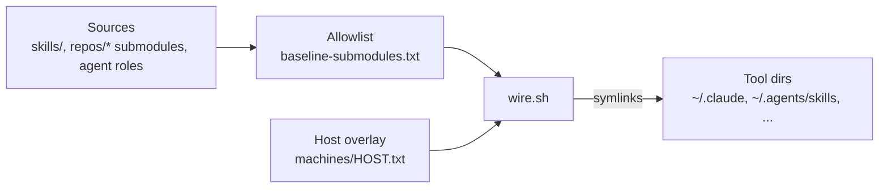
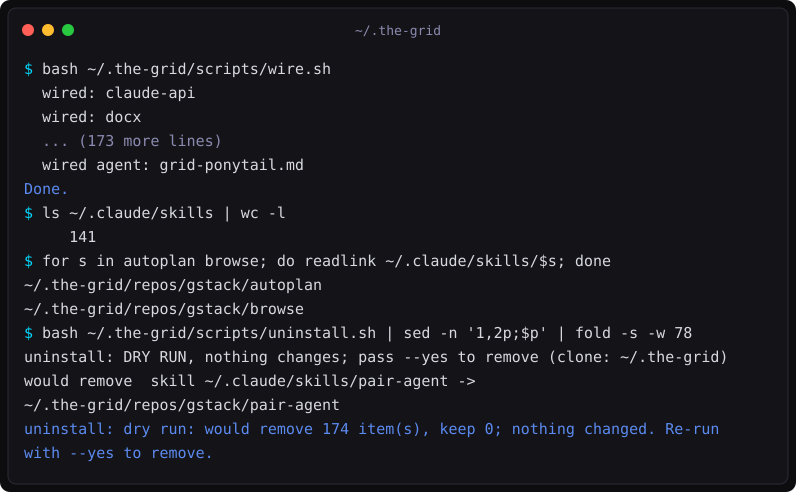

# the-grid


**Inspired by Tron. Dotfiles for your AI assistant: curated skills and agent teams, wired identically onto every machine and every AI tool you use.**

[](https://github.com/oneafrikan/the-grid/actions/workflows/tests.yml) [](LICENSE) [](https://oneafrikan.github.io/the-grid/)

Running in daily use on Claude Code, Codex CLI and Antigravity CLI. Gemini CLI, OpenCode, Pi and OpenClaw are wired too: see [Works with](#works-with). A skill is a slash command your AI tool loads, an agent is a role definition, and wired means symlinked into the tool's directory.

<!-- langs --><!-- /langs -->

## Quickstart

```bash
git clone https://github.com/oneafrikan/the-grid.git ~/.the-grid && bash ~/.the-grid/scripts/bootstrap.sh --with-agents
```

- Writes: symlinks into `~/.claude/skills` and `~/.claude/agents`, and one auto-handoff hook entry in `~/.claude/settings.json` (opt out with `-hook:auto-handoff`). All inside the clone: shallow submodule clones, `baseline-submodules.txt` and `machines/<host>.txt` seeded from the `.example` files, `core.hooksPath` set to `.githooks`, `.wired.manifest`, `SKILLS.md` and, with `--with-agents`, `agent-factory/.venv` plus `agent-factory/projects/`. Rule packs and other tools' directories only with opt-in entries. Everything it writes: [INSTALL.md](INSTALL.md) ("What it touches").
- Undo: `bash ~/.the-grid/scripts/uninstall.sh` prints what it would remove; add `--yes` to remove it. It removes only links that resolve into the clone and keeps the clone and `~/.grid`. Add `--purge` to delete both too (refused while the clone has uncommitted or unpushed work, unless `--force`). The seeded files, the venv and the `core.hooksPath` setting live inside the clone and go with it.
- Needs git, bash, and python3 (with its `venv` module) plus network access for `pip`, both to build the agent teams. Node >= 20.19 only for the `openspec-*` skills.

To look first, try the plugins. Claude Code only, no clone and no symlinks; `grid-agents@the-grid` adds the dev team ([docs/PLUGINS.md](docs/PLUGINS.md) has the limits).

```bash
claude plugin marketplace add oneafrikan/the-grid
claude plugin install grid-core@the-grid
```

Or paste this into your coding agent:

> Clone https://github.com/oneafrikan/the-grid.git to ~/.the-grid, run bash ~/.the-grid/scripts/bootstrap.sh --with-agents and tell me what it printed. If you are not Claude Code, read ~/.the-grid/docs/harnesses.md and tell me which harness: line to add for you.

You should now see:

- `bootstrap.sh` ends with `==> Bootstrap complete. Open a fresh Claude session to pick up new skills/agents.`
- `ls ~/.claude/skills | wc -l` prints a number near <!--count:wired-->91<!--/count--> (plus the orchestrator skills; duplicate names across repos collapse to one link, so it is not exact).
- In a new Claude Code session `/tron` replies with a short question about what you want to do.

Optional next steps:

- Tell the agents who you are (they say "No operator set yet." until you do): `cp ~/.the-grid/agent-factory/user.yaml.example ~/.the-grid/agent-factory/user.yaml`, fill in your name and contact, re-run the bootstrap (safe to repeat).
- gstack's browser skills (`/browse`, `/qa`, `/scrape`) need [bun](https://bun.sh) and a browser download. Until you run `bash ~/.the-grid/scripts/runtime-setup.sh gstack` (add `--dry-run` to preview), bootstrap prints `runtime MISSING: gstack`. Detail in [BOOTSTRAP.md](BOOTSTRAP.md) step 8.
- Fork first if you plan to customise; the clone URL above is read-only for you. Manual steps and the submodule-free install: [INSTALL.md](INSTALL.md). After a `git pull`, re-run `bash ~/.the-grid/scripts/wire.sh` (recompose agents first: [BOOTSTRAP.md](BOOTSTRAP.md), "Updating an existing machine").

## Works with

| Tool | What it gets | Status |
|---|---|---|
| Claude Code | skills, agents, plugins (`grid-core`, `grid-agents`), guard hooks, rule packs | running in daily use |
| Codex CLI | skills, agents (compose `--target codex`), rule packs | running in daily use |
| Antigravity CLI | skills | running in daily use |
| Gemini CLI | skills, agents (compose `--target gemini-cli`), rule packs | wired, not yet smoke-tested on a real install |
| OpenCode | skills, agents (compose `--target opencode`), rule packs | wired, not yet smoke-tested on a real install |
| Pi | skills, rule packs | wired, not yet smoke-tested on a real install |
| OpenClaw | skills | wired, not yet smoke-tested on a real install |
| Cursor | rule packs only (`scripts/rules.py emit --harness cursor`) | generated, not yet smoke-tested |

Claude Code is on by default. The rest, Cursor aside, are opt-in with one `harness:<name>` line in your machine overlay, then a re-wire:

```bash
echo 'harness:codex' >> ~/.the-grid/machines/"$(hostname -s)".txt && bash ~/.the-grid/scripts/wire.sh
```

Codex CLI, Gemini CLI, OpenCode, Pi and OpenClaw all read `~/.agents/skills`, so the skills are linked there once and reach every one of them. Agents need a compose for that tool's target first (`bootstrap.sh` composes Claude Code only). Rule packs reach a tool's instruction file (such as `~/.codex/AGENTS.md`) only if you create that file. Paths, skip rules and what is unverified per tool: [docs/harnesses.md](docs/harnesses.md).

## The problem

- "My laptop has the skill. The server does not."
- "I installed every skill pack I liked, and now each session starts buried in descriptions it never uses."
- "Claude Code, Codex and Antigravity each want their own copy of the same skills."

Not for you if you want a supported product, a GUI or a one-click installer.

## How it works

It is a dotfiles repo with one new part.

| You know it from dotfiles | In the-grid |
|---|---|
| A repo you clone to `~` | `~/.the-grid` |
| Symlinks into `$HOME` | symlinks into `~/.claude/skills`, `~/.claude/agents` and each opted-in tool's directories |
| A package list | the allowlist, `baseline-submodules.txt` |
| Per-host config | the overlay, `machines/<host>.txt` |
| (new) | agent roles written once and compiled per tool by `agent-factory/compose.py` |





Real output captured in a throwaway home: `wire.sh`, a link count, then an `uninstall.sh` dry run. The long wire listing is trimmed.

Edit a skill once and every wired copy changes, because they are links. A skill in `skills/` overrides a same-named upstream one. The full diagram, the repo layout and every step `wire.sh` takes are in [docs/architecture.md](docs/architecture.md).

Terms:

- Skill: a folder with a `SKILL.md`. Your tool loads it as a slash command or an instruction set.
- Agent (role): defined once as `role x stack x skills`. In Claude Code an orchestrator becomes a slash command and a specialist becomes a subagent.
- Wired or library: wired skills are symlinked live. Library skills are indexed in [SKILLS.md](SKILLS.md), found with `/skill-scout` and not loaded.
- Overlay: `machines/<host>.txt`, which adds or removes allowlist entries for one machine.
- Harness: an AI coding tool the-grid wires into, switched on with `harness:<name>`.

## What you get

- You choose what is live. The allowlist plus your machine's overlay decides which skills load; the rest stays on the shelf.
- <!--count:wired-->91<!--/count--> curated skills wired as slash commands (`/standup`, `/review`, `/ship`, `/skill-scout`), and <!--count:library-->80<!--/count--> more indexed and switched off.
- <!--count:roles-->40<!--/count--> agent roles: a dev team, a finance desk, a Socratic tutor (`/morpheus`), and `/tron`, which tells you which one to use.
- One `git pull` plus `wire.sh` makes every machine match.

The help skills are the entry points:

| Command | Answers |
|---|---|
| `/tron` | I have a goal: which skill or agent should I use? |
| `/grid-help` | Which slash command or subagent do I want? |
| `/openspec-help` | How do I add specs to a repo? |
| `/ponytail-help` | Which ponytail (minimum-diff) mode do I want? |

## Layers

1. Wire skills (start here; each level works without the next): `bash ~/.the-grid/scripts/bootstrap.sh` without `--with-agents` syncs the submodules and links the allowlisted skills.
2. Agent teams: `--with-agents` also composes the roles and links them. [USAGE.md](USAGE.md) covers orchestrators and specialists.
3. Build your own: [agent-factory](agent-factory/README.md) composes your own roles, [automation-factory](automation-factory/patterns/issue-loop/README.md) cuts the issue-loop into a repo, [project-factory](project-factory/README.md) seeds or retrofits a project, and the `openspec-*` skills add spec-driven planning through OpenSpec ([CONTRIBUTING.md](CONTRIBUTING.md)).

## Safe to run

- Audit before wiring. `wire.sh` runs `scripts/audit.sh` against `policy.yaml` before it touches a link. A high-severity finding blocks the run with nothing changed. [CURATION.md](CURATION.md) records why each wired repo is trusted.
- It never replaces a real directory or a foreign symlink. It only replaces links that point into the clone.
- Outside the clone, the one file it edits by default is `~/.claude/settings.json`: a single auto-handoff hook entry. Opt out with `-hook:auto-handoff` in your overlay. [SECURITY.md](SECURITY.md) and [INSTALL.md](INSTALL.md) list every write, opt-in ones included.
- `bash scripts/uninstall.sh` is a dry run until you add `--yes`. Submodules clone shallow, at their pinned commit.
- CI runs the full bats suite and the gate on every push to `main` and every ready pull request (badge above); a change that touches only documentation markdown runs a lighter docs job instead. CI runs on Linux only. The suite is written to run on macOS's Bash 3.2 too and was brought to near-green there (#301, [docs/portability.md](docs/portability.md)).

## Why "the grid"

```
The Grid.
A digital frontier.
I tried to picture clusters of information as they moved through the computer.
What did they look like?
Ships? Motorcycles?
Were the circuits like freeways?
I kept dreaming of a world I thought I'd never see.
And then, one day...
I got in.
```

Kevin Flynn, *TRON: Legacy* (2010)

Same idea, smaller scale: a shared place where your skills and agents live, and one command to get in.

<!-- OWNER: one sentence on why Tron (personal) goes here, after the quote -->

**Get in.**

```bash
git clone https://github.com/oneafrikan/the-grid.git ~/.the-grid && bash ~/.the-grid/scripts/bootstrap.sh --with-agents
```

## Status

One person's working system, shared because the mechanics are reusable. Not a supported product, and opinionated: the wiring model, the factories and the compose format are my choices.

- Versioned from v0.1.0 (tagged 2026-11-04). v0.x may still break between tags.
- Personal config is gitignored. `baseline-submodules.txt`, `machines/<host>.txt` and `LOGS/` stay untracked, and the first two ship as `.example` starting points, so a fork inherits none of my machine names or notes.
- Fork rather than depend. The transferable part is the wiring model: manifest, symlinks, compose then wire.

## Docs

- Start: [USAGE.md](USAGE.md) (daily use), [INSTALL.md](INSTALL.md) (install and what it touches), [BOOTSTRAP.md](BOOTSTRAP.md) (full boot, update, troubleshooting), [SKILLS.md](SKILLS.md) (generated skill index).
- Project: [CONTRIBUTING.md](CONTRIBUTING.md) (skills, repos, tests, the gate, OpenSpec), [SECURITY.md](SECURITY.md), [CHANGELOG.md](CHANGELOG.md), [docs/roadmap.md](docs/roadmap.md) (what is built, what is not).
- How it fits: [docs/architecture.md](docs/architecture.md) (full diagram, repo layout, complete docs index), [docs/harnesses.md](docs/harnesses.md) (other tools), [docs/PLUGINS.md](docs/PLUGINS.md) (plugin limits), [docs/rules.md](docs/rules.md) (rule packs), [hooks/README.md](hooks/README.md) (guard and auto-handoff hooks).
- Going further: [docs/private-projects.md](docs/private-projects.md) (a private desk), [docs/model-selection.md](docs/model-selection.md) (which model for which job), [docs/portability.md](docs/portability.md) (scripts that run on Linux and macOS).
- Factories: [agent-factory](agent-factory/README.md), [automation-factory](automation-factory/patterns/issue-loop/README.md), [project-factory](project-factory/README.md).
- Optional companion, a separate repo the-grid does not depend on: [grid-fleet](https://github.com/oneafrikan/grid-fleet), a terminal dashboard for Claude Code sessions, tokens, subagent usage and limits across machines.

## Credits and license

Wires skills from upstream projects, listed with licences in [docs/SOURCES.md](docs/SOURCES.md). Built by [Gareth Knight](https://github.com/oneafrikan). MIT licensed ([LICENSE](LICENSE)); submodules under `repos/` keep their own licences.
