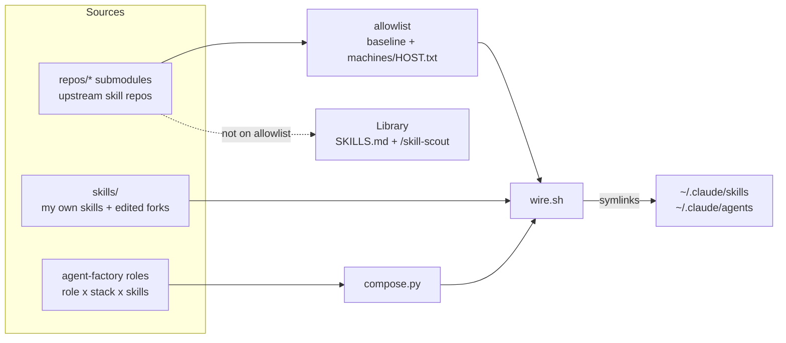

# the-grid

**Inspired by Tron. Dotfiles for your AI assistant: curated skills and agent teams, wired identically onto every machine and every AI tool you use.**

[](https://github.com/oneafrikan/the-grid/actions/workflows/tests.yml) [](LICENSE) [](https://oneafrikan.github.io/the-grid/)

Works today with Claude Code. Other AI tools: see [docs/roadmap.md](docs/roadmap.md).

<!-- langs --><!-- /langs -->

```
████████╗██╗  ██╗███████╗    ██████╗ ██████╗ ██╗██████╗ 
╚══██╔══╝██║  ██║██╔════╝    ██╔════╝██╔══██╗██║██╔══██╗
   ██║   ███████║█████╗      ██║  ███╗██████╔╝██║██║  ██║
   ██║   ██╔══██║██╔══╝      ██║   ██║██╔══██╗██║██║  ██║
   ██║   ██║  ██║███████╗    ╚██████╔╝██║  ██║██║██████╔╝
   ╚═╝   ╚═╝  ╚═╝╚══════╝     ╚═════╝ ╚═╝  ╚═╝╚═╝╚══════╝
 _______________________________________________________
 \_ \_ \_ \_ \_ \_ \_ \_ \_ \_ \_ \_ \_ \_ \_ \_ \_ \_ _/
```

## Who it's for

- You use more than one machine (laptop, server, work, home) and your Claude Code setup keeps drifting between them.
- You collect skills from many repos and installing everything buries your session. You want a short live list and a searchable shelf.
- You build agent teams (tech lead, QA, security reviewer) and want each role defined once and wired the same everywhere.
- Not for you if you want a supported product, a GUI or a one-click installer. I built this for my own machines and share it because the mechanics are reusable.

## Quickstart

```bash
git clone https://github.com/oneafrikan/the-grid.git ~/.the-grid && bash ~/.the-grid/scripts/bootstrap.sh --with-agents
```

Needs git, bash, python3 (for the agent teams) and Claude Code. Node >= 20.19 only if you use the openspec-* skills (see [INSTALL.md](INSTALL.md)).

You should now see:

- `bootstrap.sh` ends with `==> Bootstrap complete. Open a fresh Claude session to pick up new skills/agents.`
- `ls ~/.claude/skills | wc -l` prints a number near <!--count:wired-->132<!--/count--> (plus the orchestrator skills; duplicate skill names across repos collapse to one link, so it is not exact), and `ls ~/.claude/skills/tron` lists a `SKILL.md`.
- In a new Claude Code session `/tron` replies with a short question about what you want to do.

Fork first if you plan to customise: the clone URL above is read-only for you.

Or paste this into Claude:

> Clone https://github.com/oneafrikan/the-grid.git to ~/.the-grid, run bash ~/.the-grid/scripts/bootstrap.sh --with-agents, tell me what it printed, then tell me to open a fresh session and run /tron.

Stop there. If it felt useful, read [USAGE.md](USAGE.md).

- Prefer the manual steps, or a machine without submodules? See [INSTALL.md](INSTALL.md).
- Already set up and just pulled? Run `bash scripts/wire.sh` again. Composed agents need a recompose first: see [BOOTSTRAP.md](BOOTSTRAP.md) ("Updating an existing machine").

## What you get

- <!--count:wired-->132<!--/count--> curated skills as slash commands (/standup, /review, /ship, /skill-scout). <!--count:library-->100<!--/count--> more sit on a searchable shelf, switched off.
- <!--count:roles-->40<!--/count--> ready-made agent roles: a dev team, a finance desk, a Socratic tutor (/morpheus), and /tron, which tells you which one to use.
- One git pull plus wire.sh makes every machine identical; a per-machine overlay handles the differences.
- Project templates with specs and agents already wired in.

Lost? The help skills are the entry point:

| Command | Answers |
|---|---|
| `/tron` | I have a goal: which skill or agent should I use? |
| `/grid-help` | Which slash command or subagent do I want? |
| `/openspec-help` | How do I add specs to a repo? |
| `/ponytail-help` | Which ponytail (minimum-diff) mode do I want? |

## How it works



- **Wired vs library.** Only repos on the allowlist are symlinked live. Everything else is indexed in [SKILLS.md](SKILLS.md) and found with `/skill-scout`.
- **Per-machine overlay.** A shared baseline plus an optional `machines/<host>.txt` adds or removes entries for one machine.
- **Symlinks, not copies.** Edit a skill once and every wired copy changes. A skill in `skills/` overrides a same-named upstream one.
- **Agents compiled from one source.** `compose.py` builds each role from `role x stack x skills`; `wire.sh` links the result.

Four sibling pieces produce the assets: `agent-factory/` (agent teams), `automation-factory/` (reusable automation patterns), `project-factory/` (project templates) and the skill wiring itself.
The layout, every script and the full `wire.sh` sequence are in [docs/architecture.md](docs/architecture.md).

## Why "the grid"

```
The Grid.
A digital frontier.
I tried to picture clusters of information as they moved through the computer.
What did they look like?
Ships? Motorcycles?
Were the circuits like freeways?
I kept dreaming of a world I thought I'd never see.
And then, one day...
I got in.
```

Kevin Flynn, *TRON: Legacy* (2010)

Same idea, smaller scale: a shared place where your skills and agents live, and one command to get in.

## Status

This is one person's working system, shared because the mechanics are reusable, not a supported product.

- **It will change under you.** Versioned from v0.1.0; v0.x may still break between tags.
- **It is opinionated.** The wiring model, the factories and the compose format are my choices, not a consensus design.
- **Personal config is gitignored, not mixed in.** `baseline-submodules.txt`, `machines/<host>.txt` and the dev-journal `LOGS/` convention are personal and untracked. You get a generic `.example` starting point for the first two and owe nothing for the third. A fork never inherits my machine names, account routing or notes.
- **Fork rather than depend.** The wiring model (manifest, symlinks, compose-then-wire) is the transferable part. Copy it and point it at your own skills.
- **`wire.sh` mostly writes symlinks that point into this repo, but not only.** It never clobbers a real directory or a foreign symlink in `~/.claude/skills/`. It also keeps one auto-handoff hook entry in `~/.claude/settings.json` (on by default; opt out with `-hook:auto-handoff`). With opt-in entries it links rule packs under `~/.claude/rules/grid/` and other harness directories. Inside the clone it writes `.wired.manifest` and `SKILLS.md`. The full list is in [INSTALL.md](INSTALL.md) ("What it touches"). Read the script before running it; it writes to your home directory.

## Docs

- [USAGE.md](USAGE.md): daily use, orchestrators vs specialists, promoting a library skill.
- [INSTALL.md](INSTALL.md): the short install guide and what the scripts touch.
- [BOOTSTRAP.md](BOOTSTRAP.md): the full boot, update and troubleshooting reference.
- [SKILLS.md](SKILLS.md): generated index of every skill.
- [CONTRIBUTING.md](CONTRIBUTING.md): adding skills and repos, running tests, the gate.
- [SECURITY.md](SECURITY.md): what the scripts write and how to report a problem.
- [CHANGELOG.md](CHANGELOG.md): release notes.
- [docs/architecture.md](docs/architecture.md): how the pieces fit, and the complete docs index.
- [docs/roadmap.md](docs/roadmap.md): what is built, what is not.
- [docs/private-projects.md](docs/private-projects.md): keeping a private desk out of the public repo.
- [docs/model-selection.md](docs/model-selection.md): which model for which job, with prices.
- [docs/rules.md](docs/rules.md): opt-in coding-convention rule packs.
- [docs/harnesses.md](docs/harnesses.md): other AI tools (Codex CLI, OpenCode, Gemini CLI).
- [hooks/README.md](hooks/README.md): guard hooks and the auto-handoff hook.
- [CURATION.md](CURATION.md): why each wired repo is trusted.
- [agent-factory/README.md](agent-factory/README.md): composing agent teams.
- [project-factory/README.md](project-factory/README.md): scaffolding new projects.

Spec-driven development uses OpenSpec, wired on every machine (the `openspec-*` skills).
The convention and the two thin layers the-grid adds are described in [CONTRIBUTING.md](CONTRIBUTING.md).
Run `/openspec-help` for the reference card.

## Credits and license

Wires skills from upstream projects, listed with licences in [docs/SOURCES.md](docs/SOURCES.md).

Built by [Gareth Knight](https://github.com/oneafrikan). MIT licensed ([LICENSE](LICENSE)); submodules under `repos/` keep their own licences.
